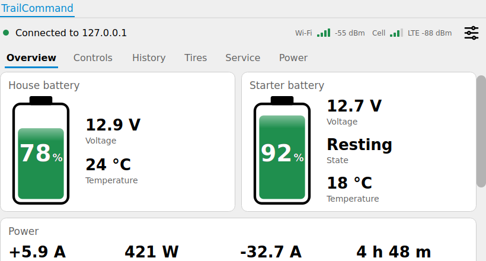
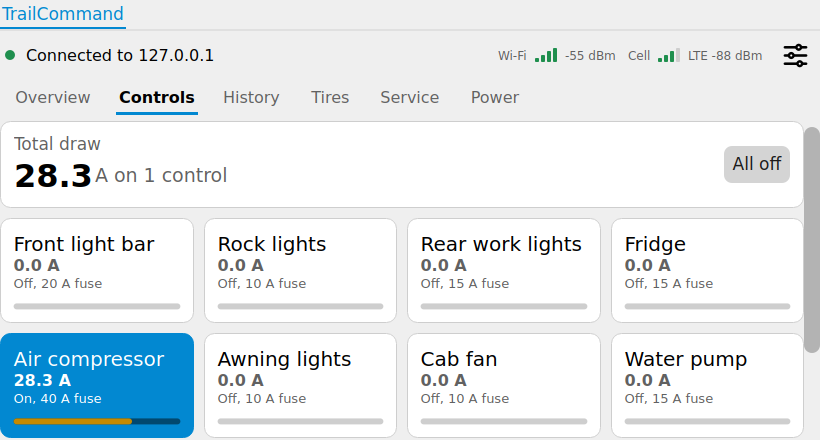
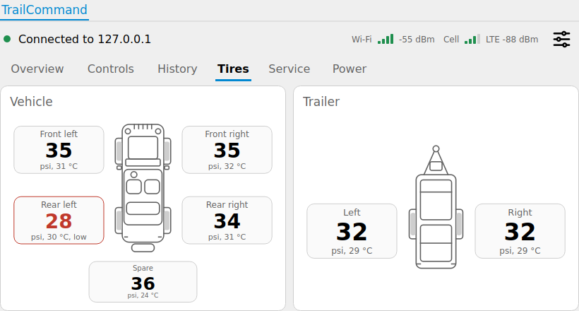
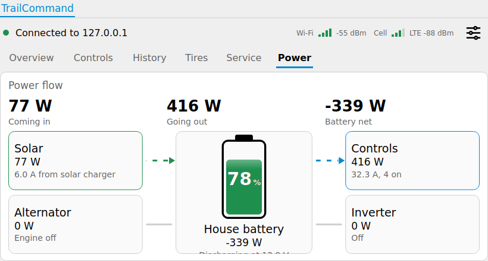

# TrailCommand for OpenDash

An [OpenDash](https://github.com/openDsh/dash) plugin that shows your TrailCommand hub on the Dash head
unit: batteries, controls, history, tires, service and the power flow. It talks to the hub over your
network, the same way the web dashboard does.

| | |
|---|---|
|  |  |
|  |  |

## What it shows

- **Overview:** house and starter battery with charge and colour band, power, loads and what needs attention.
- **Controls:** a tile per control. Tap to switch it, **All off** switches everything off. Live amps and fuse load.
- **History:** charge level for 6 h, 24 h, 7 days or 30 days, and amp-hours per day.
- **Tires:** top-down vehicle and trailer drawings with the pressure and temperature at each wheel.
- **Service:** odometer, maintenance schedule and **Log service**.
- **Power:** sources, battery and loads with dashes moving along the paths that carry power.
- **Status icons in Dash's bottom control bar** (left of the power button): date and time (12 or 24 hour, following the hub's clock setting), hub link, Wi-Fi and cell signal (the last two appear when the hub has a Wi-Fi adapter or modem). Tapping the hub icon opens the connection settings. Dash has no plugin hook for that bar, so the plugin finds the widget named `ControlBar` and adds the icons itself (`statusbar.hpp`); more icons are one `add()` and `set()` call each.
- **Settings button:** at the right end of the tab row, in line with Overview, Controls and so on.

There is no settings page, on purpose: change names, units, alerts, devices and so on in the hub's web
dashboard. The plugin follows those settings (units, battery names, which panels to show).

## Connecting to the hub

The **settings button** at the top right opens the connection dialog:

- **Address and port** of the hub (default port 8080).
- **Scan network** looks for hubs: every address on the connected IPv4 networks (up to a /22) and this
  machine, on ports 8080 and 80 plus the port you typed. A hub is recognised by its `/api/health` reply, so the
  hub must be the build that includes it. A hub running on the same device as Dash is listed once, as
  `127.0.0.1`. Pick one from the list (double-tap to connect at once).
- **PIN**, if the hub has one. You can also leave it empty: the plugin asks when the hub first refuses a change.
  "Remember the PIN" stores it in Dash's settings file; leave it off to ask again after every restart.
- **Secure connection (HTTPS)** and **Trust the hub's own certificate** for a hub built with TLS and a self-signed
  certificate.
- **Test connection** checks the address before you connect.

On first start the tab shows **Find my hub** and **Enter address**. The connection is remembered and the
tab reconnects by itself; while the hub is unreachable the hub icon in the control bar turns red and it keeps retrying.

## Installing

OpenDash plugins are built together with Dash, so the plugin goes into a Dash source checkout:

```sh
./install.sh /path/to/dash        # copies plugins/vehicle/trailcommand into the checkout
# rebuild Dash as described in its README
```

Then in Dash: **Vehicle** page, tap its settings button, choose the plugin **trailcommand** and press **load**. A
**TrailCommand** tab appears next to **Data**. Dash loads one vehicle plugin at a time, so choosing this one replaces
another vehicle plugin you had selected (the built-in Data tab stays).

Requirements are Dash's own: Qt 5 (the plugin avoids anything newer than Qt 5.11, but has only been built on
5.15), C++14, and the Qt WebSockets module Dash already uses. It needs no CAN bus or OpenAuto code.

## How it fits in

- Written as a **vehicle plugin** (`VehiclePlugin`): it adds one tab through `widgets()` and ignores the CAN bus.
- Everything lives in namespace `tc`, so its class names cannot clash with Dash's, which exports its symbols.
- Colours come from Dash: light or dark mode (`Theme/mode`) and the accent colour stored in the application palette.
  Standard widgets (buttons, dialogs) use Dash's style sheet.
- The tab is scrollable, with drag-to-scroll for touch screens, and lays out down to about 700 by 300 pixels.

## Testing

`test/run_tests.sh <dash-checkout> <hub-binary> <hub-web-dir>` builds the plugin against the real Dash headers
(only Dash's CAN-bus header is replaced by a stand-in, because it needs OpenAuto), loads it with `QPluginLoader` as
Dash does, and drives it in a headless Qt host against a running hub, in light and dark mode. 25 checks:
scanning (one hub found once), connecting, live values, control-bar icons, tapping a control, All off, history ranges, Log
service, the PIN prompt and the moving power-flow animation. It also writes screenshots of every page.

On the head unit, Ozark OS builds the plugin into Dash (every `.cpp` in its folder, as Dash's build expects) and runs it on the Raspberry Pi with touch input.

## Files

```
plugins/vehicle/trailcommand/   the plugin (copy this into Dash)
install.sh                      copies it into a Dash checkout
test/                           headless test host and run_tests.sh
docs/                           screenshots
```
